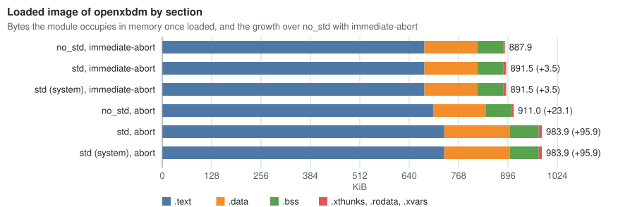
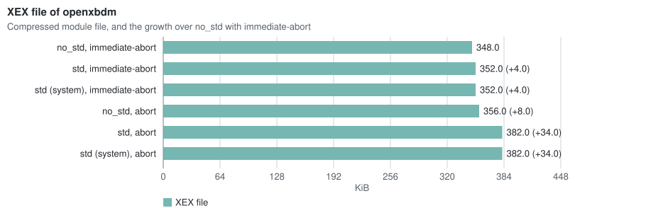

# Xbox 360 Rust and LLVM Toolchain

A toolchain that compiles Rust (and any other LLVM language, such as C) to a XEX
executable that runs on the Xbox 360. It replaces Microsoft's proprietary
toolchain. The default targets 32-bit big-endian PowerPC; the experimental
PPC64 mode uses 64-bit registers with the console's ELF32 ABI and 32-bit
pointers. A single post-link step, `xex-link`, converts the resulting ELF into
a devkit-signed XEX.

The standard library is supported through an overlay that teaches Rust std about
the `xbox360` target. A title may therefore use `std::thread`, `std::net`,
`std::fs`, allocation, and `println!`.

## Requirements

- For Buck2 builds: nothing to install beyond the host tools below. Run
  `bin/buck2` (`bin\buck2.cmd` on Windows) wherever this file says `buck2`,
  or add `bin` to `PATH`. Its first run runs `bootstrap.sh`
  (`bootstrap.ps1` on Windows), which downloads
  [DotSlash](https://dotslash-cli.com) into `.tools`, fetches the Buck2
  release that the DotSlash file `toolchains/buck2` pins, and reports
  missing host tools. Buck2 downloads the Rust 1.98.0 release, a CPython
  for its own tools, and every crate it builds, and checks each download
  against a pinned digest.
- A C++ linker driver for the host programs (`xex-link`,
  `xbox360-asm-rewrite`): GCC or Clang on Linux, the Xcode command line
  tools on macOS, or Visual Studio Build Tools with the C++ workload on
  Windows. These stay host tools: the macOS and Windows SDKs cannot be
  redistributed. Windows also needs long paths enabled.
- Python 3.11 or later, only for the `buck/update_*.py` scripts.
- For Cargo builds: `rustup`, the Rust 1.98.0 toolchain, and its `rust-src`
  component. The standard-library overlay is written against the 1.98
  standard-library source; other versions are not supported.
- Xenia, built separately, for verification. The helper script
  `tools/run-xenia.sh` invokes it.
- For C titles with the release toolchain: `clang` with the PowerPC target,
  on the `PATH` of the Buck2 daemon. Run `buck2 kill` after changing `PATH`.
  The optional source-built toolchain supplies its own clang.
- For the PPC64 source-built toolchain on Linux: CMake, Ninja, a C and C++
  compiler, binutils, `patch`, and Python 3. A Nix shell can provide them:
  `nix-shell -p cmake ninja gcc binutils patch python3`.

`xex-link` builds the XEX with the `xex2` and `xenon_types` crates of the [acceleration](https://github.com/landaire/acceleration) project, pinned to a Git commit.

## Building with Buck2

Buck2 builds the standard library from the release's `rust-src` archive with
the overlay applied (`sysroot/BUCK`), so no installed Rust and no overlay step
are needed:

```
buck2 build //examples/... --show-output
```

This builds the XEX of every example. `buck2 build //examples/hello:hello`
builds one.

To move to another Buck2 release, replace `toolchains/buck2` with the `buck2` DotSlash file of that release, `https://github.com/facebook/buck2/releases/download/<tag>/buck2`. To move to another DotSlash release, change the version and SHA-256 values in both bootstrap scripts and run them again.

`xbox360_title` in `buck/xex.bzl` builds a title. It compiles a Rust executable for the console, with or without the standard library, and converts it with `xex-link` (`//crates/xex-link:xex-link`) using the title's manifest. `buck2 run toolchains//:llvm-objdump -- ARGS` runs the Rust release's llvm-objdump.

### Experimental source-built compiler

The default `ppc32` toolchain keeps the release Rust compiler and existing
`powerpc-unknown-xbox360` target. The experimental `ppc64` toolchain uses a
source-built Rust 1.98 compiler and matching LLVM revision, then targets
`powerpc64-unknown-xbox360`.

Initialize only the source submodules that the compiler build needs. Do not use
`--recursive`; the Rust repository's LLVM submodule is not used:

```
git submodule update --init toolchain/buck2-rustc-bootstrap
git -C toolchain/buck2-rustc-bootstrap submodule update --init rust
git -C toolchain/buck2-rustc-bootstrap/rust \
  submodule update --init library/backtrace
```

Build the compiler distributions once:

```
nix-shell -p cmake ninja clang gcc binutils python3 --run \
  'python3 buck/build_custom_toolchain.py --jobs 4'
```

The bootstrap has its own Buck root and cache. Rust crates are native Buck
actions. LLVM, clang, and LLD use their CMake/Ninja build because LLVM is not
buckified. That build state lives in
`$XDG_CACHE_HOME/buck2-rustc-bootstrap/xbox360-llvm`, or the corresponding
directory under `~/.cache` when `XDG_CACHE_HOME` is unset. The builder mirrors
new LLVM archives there without touching unchanged files, so a one-file LLVM
change rebuilds that file rather than the project.

The resulting LLVM, clang, LLD, rustc, rustdoc, clippy-driver, and host standard
library are installed in the ignored `toolchain/local-llvm` and
`toolchain/local-rust` directories, which the main Buck graph imports. An
unchanged setup invocation returns without replacing either directory.
`--jobs` limits both Buck's Rust actions and LLVM's nested Ninja build; lower it
on a memory-constrained host.

Select exactly one toolchain with `xbox360.toolchain`; omitting it selects
`ppc32`:

```
bin/buck2 build -j 4 -c xbox360.toolchain=ppc64 \
  //examples/hello:hello //examples/stdhello:stdhello //examples/chello:chello
```

The source-built stack pins these revisions:

- `landaire/llvm-project` branch `xbox360-abi-rust-1.98`, commit
  `aa06e8ebabae50f409c60fd8717ae57201a5034f`;
- `landaire-contrib/buck2-rustc-bootstrap` branch `xbox360-rust-1.98`, commit
  `5004141b91ea89e8436988255abe8c56a152fcf5`;
- `landaire/rust` branch `xbox360-abi-rust-1.98`, commit
  `e52263c3cec8ece1b4b0ff1b00d56c0b5218d498`.

The bootstrap downloads LLVM as a digest-checked archive. LLVM is not a
submodule. The bootstrap submodule pins the Rust source revision and its small
Xbox target patch.

The reusable main-graph targets are `toolchains//:custom-llvm` and
`toolchains//:rust-release`. `toolchains//:clang`,
`toolchains//:rust-lld`, `toolchains//:llvm-objdump`, and
`toolchains//:llvm-objcopy` expose individual tools.

The PPC64 build still produces big-endian `elf32-powerpc` intermediates and
32-bit addresses. Its ABI bridges use 64-bit `std` and `ld` instructions to
preserve the full nonvolatile registers. The final targets remain XEX files.

Pass `rewrite = True` to make the title smaller. The executable is then compiled as one fat LTO unit, and `xbox360-asm-rewrite` replaces the register saves and restores in each function's prologue and epilogue with calls to shared helper routines, as Microsoft's compiler does. The build fails if the relinked image differs from the one rustc links, or if a rewritable sequence remains. `examples/stdhello` uses it. The `[rewrite-report]` and `[refusals]` subtargets show what changed and what was left alone.

Pass `std = "system"` instead of `std = True` for a system module, a XEX without the `TITLE` module flag that runs in the system process. The executable then links the standard library for system modules (`xbox360//sysroot:std-system`, built with `--cfg xbox360_system`). Its `std::thread` threads start in the system process, so they keep running when the title exits, and its sockets open as the system rather than as the title. Its thread locals take TLS slots of the system process, which never exits. The module returns them with `std::os::xbox360::release_tls_slots` when it unloads. `toolchain/rust-std-xbox360/README.md` has the details.

Every title build also fails if the image holds an `lwarx`, `ldarx`, `stwcx.` or `stdcx.` outside the interrupt-protected form. The devkit kernel loader reports those as unprotected. `xbox360_sys::interlocked` has operations in the protected form.

For projects that generate their own build files, `xbox360_executable_core`, `xbox360_executable_std`, `xbox360_executable_std_system` and `xex_from_assembly` are the rules behind `rewrite`.

### Debugging

Every title keeps its symbols and debug information in its ELF, including with `rewrite`. The XEX does not carry them, so it does not grow.

- `[elf]` is the ELF. Its addresses are the addresses the console loads the title at, so a debugger uses it as is.
- `[gdb]` and `[lldb]` are command files that load the ELF and find the standard library source.

On a devkit with kdnet enabled, `openxbdm-kd` from [xeedee](https://github.com/landaire/xeedee) serves the console's kernel debugger to GDB or LLDB. Titles are 32-bit PowerPC code, so start it with `--registers 32`. `--stop-on-load` holds the title after it loads and before it runs, so you can set breakpoints first. Run the debugger from the repository root, because the source paths in the debug information are relative to it:

```
openxbdm-kd gdbserver --registers 32 --stop-on-load stdhello.xex
gdb -x "$(buck2 build //examples/stdhello:stdhello[gdb] --show-simple-output)" -ex 'target remote 127.0.0.1:2159'
lldb -s "$(buck2 build //examples/stdhello:stdhello[lldb] --show-simple-output)" -o 'gdb-remote 127.0.0.1:2159'
```

With Cargo, the examples' release profile keeps debug information (`debug = "full"`). Load the ELF from `target/powerpc-unknown-xbox360/release`.

### Libraries

Use std when you can. For what std does not cover, or for code without std, two crates are published on crates.io:

- [`xbox360-sys`](crates/xbox360-sys): raw kernel and XAM imports, exports, entries for callers that use the console ABI, and the interlocked operations the kernel loader accepts. std builds on it.
- [`xbox360`](crates/xbox360): safe wrappers on top of it, such as kernel events and locks, threads without std, controller input and saved-game content.

### From another Buck2 project

A project that builds for the host and the console uses this repository as
the `xbox360` external cell, pinned to a commit:

```ini
[cells]
  xbox360 = rust-xbox360

[external_cells]
  xbox360 = git

[external_cell_xbox360]
  git_origin = https://github.com/landaire/rust-xbox360
  commit_hash = <commit>
```

Its `toolchains/BUCK` calls `xbox360_toolchains()` from `@xbox360//buck:toolchains.bzl`, which takes the project's rustc and rustdoc flags for host and console crates. The target constraint is `xbox360//platforms:target`, with the generated `[host]` and `[xbox]` values. Console targets use `xbox360_title`, or the `xbox360//platforms:xbox360-core`, `-std` and `-std-system` configurations through the transitions in `buck/platforms.bzl`.

To select the PPC64 dogfood toolchain from an external project, add this to the
project's root `.buckconfig`:

```ini
[xbox360]
  toolchain = ppc64
```

Pass the same choice from the project's `toolchains/BUCK`. Use `ppc32` instead
to select the existing release toolchain:

```python
load("@xbox360//buck:toolchains.bzl", "xbox360_toolchains")

xbox360_toolchains(
    toolchain = read_root_config("xbox360", "toolchain", "ppc32"),
)
```

The `ppc64` mode requires this repository to be a local cell with the compiler
distributions installed by `buck/build_custom_toolchain.py`. The default
`ppc32` mode still works from the Git external cell without them.

`@xbox360//buck:profiles.bzl` provides dev, release and symbol-free release flags for the shared `xbox360//platforms:mode` constraint. A project may expose it as `//config:mode` with an `alias`, but its `PACKAGE` modifier aliases must name `xbox360//platforms:mode[dev]`, `[release]` and `[release-no-symbols]` directly. Its `profiled_rust_binary` keeps Linux debug information in the `[symbols]` subtarget and leaves the executable stripped. The project's `rust-toolchain.toml` should name the release in `buck/rust_release.bzl`; `buck/update_rust_release.py --check PATH` compares them.

## Getting started with Cargo

This procedure assumes no prior experience modifying the Rust toolchain. It
proceeds from a machine with nothing installed to a running title. Commands are
run from the repository root unless stated otherwise.

### 1. Install Rust

Install `rustup` by following the instructions at https://rustup.rs. Then install
the required toolchain and components:

```
rustup toolchain install 1.98.0
rustup component add rust-src --toolchain 1.98.0
```

Direct this repository to use that toolchain. Run this once, in the repository
root:

```
rustup override set 1.98.0
```

### 2. Install the standard-library overlay

`toolchain/rust-std-xbox360/library` holds the overlay as complete files of
the standard-library source: the Xbox 360 backend and the files with its
dispatch edits. Copy it over the toolchain's standard-library source once
(repeat it after every `rustup update` or `rustup component add rust-src`,
which restore the pristine source):

```
cp -R toolchain/rust-std-xbox360/library/. "$(rustc --print sysroot)/lib/rustlib/src/rust/library/"
```

The edits apply only to the `xbox360` target and are inert for all others.

### 3. Build the linker

`xex-link` is a host program that converts an ELF into a XEX:

```
cargo build -p xex-link
```

The binary is written to `target/debug/xex-link`.

### 4. Compile and run a title without the standard library

Each Rust example except `library-check` is a self-contained crate that selects the target and linker script through its `.cargo/config.toml`. Because the target is a specification file and the build compiles part of the library from source, the build requires `RUSTC_BOOTSTRAP=1` and `-Zjson-target-spec`.

Compile the `hello` example to an ELF executable:

```
cd examples/hello
RUSTC_BOOTSTRAP=1 cargo build --release -Zjson-target-spec
```

The ELF is written to `target/powerpc-unknown-xbox360/release/hello`. Convert it
to a XEX with the metadata in the example's `xex.toml`:

```
../../target/debug/xex-link \
  target/powerpc-unknown-xbox360/release/hello hello.xex \
  --manifest xex.toml
```

Run it under Xenia:

```
../../tools/run-xenia.sh hello.xex --gpu=null --apu=nop
```

### 5. Compile and run a title with the standard library

Standard-library titles additionally build the standard library from the
overlaid source. Compile the `stdhello` example:

```
cd examples/stdhello
RUSTC_BOOTSTRAP=1 cargo build --release -Zbuild-std=std,panic_abort -Zjson-target-spec
```

The first build compiles the standard library and takes several minutes;
subsequent builds reuse the cached result. Convert and run it as in step 4.

If you edit the overlay after building, delete the standard-library build cache
before rebuilding; Cargo does not detect changes to the overlaid source:

```
rm -rf "${CARGO_HOME:-$HOME/.cargo}/build/powerpc-unknown-xbox360"
```

Copy the edited files into the toolchain source first, as in step 2.

## Size cost of the standard library

Console memory is shared with the running title, so every kilobyte of a module counts. These numbers come from [openxbdm](https://github.com/landaire/xeedee), a debug monitor module that takes about 890 KiB once loaded. It calls no std API, so the growth is what std costs before you use it. Each build uses `-Copt-level=z`, one fat LTO unit and `rewrite`.





| Standard library | Panic strategy | `.text` | `.data` | `.bss` | `.xthunks` | Loaded image | XEX file |
| --- | --- | ---: | ---: | ---: | ---: | ---: | ---: |
| None (`no_std`) | `immediate-abort` | 695,724 | 140,146 | 68,912 | 3,648 | 909,250 | 356,352 |
| `std` | `immediate-abort` | 695,716 | 140,146 | 68,928 | 7,248 | 912,858 | 360,448 |
| `std` for system modules | `immediate-abort` | 695,716 | 140,146 | 68,928 | 7,248 | 912,858 | 360,448 |
| None (`no_std`) | `abort` | 718,884 | 140,594 | 68,912 | 3,648 | 932,858 | 364,544 |
| `std` | `abort` | 748,492 | 173,594 | 77,188 | 7,376 | 1,007,470 | 391,168 |
| `std` for system modules | `abort` | 748,492 | 173,594 | 77,188 | 7,376 | 1,007,470 | 391,168 |

Sizes are in bytes. The loaded image is every section the loader maps, `.rodata` (784 bytes) and `.xvars` (36 bytes) included.

- The two std builds are the same size. `--cfg xbox360_system` changes only thread and socket code, which openxbdm does not call.
- Linking std adds 3.5 KiB, all of it in `.xthunks`. std links its own copy of `xbox360-sys` (0.1.0) next to the module's (0.2), and each of the 227 imports the module keeps gets an import record from both copies.
- `-Cpanic=immediate-abort` makes every panic a trap with no message. A panic hook (`std::panic::set_hook`) needs `-Cpanic=abort` instead. That adds 23.1 KiB without std and 95.9 KiB with it.

## Repository layout

| Path | Contents |
| --- | --- |
| `crates/xex-link` | The ELF-to-XEX linker (the post-link step). |
| `crates/xbox360-asm-rewrite` | The register save and restore rewrite, and the reservation check. |
| `crates/xbox360-sys` | Kernel and XAM imports, exports and console-ABI entry bridges. |
| `crates/xbox360` | Safe wrappers over `xbox360-sys`. |
| `targets/` | The custom rustc target specification. |
| `toolchain/rust-std-xbox360` | The standard-library overlay. |
| `sysroot/` | Buck2 rules for the standard library crates. |
| `buck/`, `platforms/`, `toolchains/` | Buck2 rules, configurations and toolchains. |
| `third-party/rust` | Buck2 rules for the crates.io dependencies of the host crates and the examples (`reindeer buckify`). |
| `examples/` | Sample titles (see below). |
| `tools/` | Helper scripts and the `xbdbg` devkit debugger. |
| `docs/` | Reference material. |

## Running under Xenia

```
tools/run-xenia.sh <title>.xex --gpu=null --apu=nop
```

The script launches a headless Xenia build and writes its log to standard
output. Xenia does not exit when the title's main thread returns, so runs end at
the timeout; inspect the log rather than the exit code. Set the Xenia path and
timeout at the top of the script if required.

## Compiling C

`xex-link` is language-agnostic: any LLVM front end that emits a big-endian
PowerPC ELF is supported. `xbox360_c_title` in `buck/xex.bzl` compiles C
sources with `toolchains//:clang`
(`--target=powerpc64-unknown-xbox360 -ffreestanding -fno-builtin`), links them
with `toolchains//:rust-lld`, and converts the result with `xex-link`. The C
example demonstrates the full path:

```
buck2 build //examples/chello:chello --show-output
```

The release configuration resolves `toolchains//:clang` from the Buck2
daemon's `PATH`; that clang must include the PowerPC target
(`clang -print-targets`). The source-built configuration uses its pinned custom
clang. No C library exists for the console. The title declares its imports as
thunks in the `.xthunks` section, as `examples/chello/hello.c` does.

## Linker options

`xex-link` reads the XEX metadata from a TOML manifest:

```
usage: xex-link <input.elf> <output.xex> [--manifest PATH] [--resource NAME=PATH]...
```

`--resource NAME=PATH` embeds a file in the image as the resource `NAME` (1 to 8 bytes, case-sensitive), which the title reads in place with `xbox360::module::resource`. With Buck2, pass `resources = {"NAME": "file or target"}` to `xbox360_title`.

Every key is optional; an absent key, or an absent `--manifest`, takes the
default shown. Commented keys have no default. Unknown keys are rejected.

```toml
title_id = 0x00000000       # integer
media_id = 0x00000000       # integer
load_address = 0x82000000   # image base the ELF was linked at
version = "0.0.0.0"         # title and export table version: a.b.c.d or "0xHEX"
base_version = "0.0.0.0"    # minimum loader version, same format
image_flags = []            # ImageFlags names or "0xHEX", e.g. ["SMALL_PAGES"]
module_flags = ["TITLE"]    # ModuleFlags names or "0xHEX"
compress = false            # LZX-compress the image (Normal, 64 KB window)
tls_slots = 64              # TLS_INFO slots, 0 omits the header; default 64 with TITLE, none otherwise
# bounding_path = '\Device\Harddisk0\Partition1\DEVKIT\FlashEx\xbdm.xex'
# encrypt = "devkit"        # encrypt with the "devkit" or "retail" master key

[imports]
version = "2.0.21173.0"     # imported module version
min_version = "2.0.1861.0"  # minimum imported module version

# Emits an export table; module is required when the table is present.
# [exports]
# module = "xbdm.xex"       # xboxkrnl.exe, xam.xex, or xbdm.xex
# min_version = "2.0.1861.0" # oldest compatible version in the export table
```

The load address must match the image base the ELF was linked at and must be a
multiple of the page size: 64 KB, or 4 KB with `SMALL_PAGES`.

## Examples

| Example | Standard library | Description |
| --- | --- | --- |
| `hello` | No | Networking and threads; sends a UDP datagram from a worker thread. |
| `hello2` | No | Minimal title that calls `DbgPrint`. |
| `blink` | No | Prints a counter with `DbgPrint` about once a second. |
| `threads` | No | Spawns and joins a worker thread. |
| `net` | No | Sends a UDP datagram. |
| `noimp` | No | Title with no imports; writes to a memory heartbeat. |
| `library-check` | No | Checks each module of the `xbox360` crate. |
| `resources` | No | Reads two files that the image embeds as resources. |
| `stdhello` | Yes | Allocation, threads, and files. |
| `tokweb` | Yes | tokio async runtime with an HTTP request to a host server. |
| `chello` | No | C title, built with `clang`. |

Every example builds with Buck2. With Cargo, the Rust titles marked "No" other than `library-check` and `resources` build with step 4, and those marked "Yes" with step 5. `hello2`, `threads`, `net` and `chello` declare their own import thunks instead of using `xbox360-sys`.

## Further reading

- `ARCHITECTURE.md`: target ABI, the pipeline, imports, threading, and
  networking.
- `ROADMAP.md`: milestones and their verification status.
- `toolchain/rust-std-xbox360/README.md`: the standard-library overlay in
  detail, including the protected-atomics backend.
- `docs/llvm-integration.md`: why the ELF-to-XEX conversion is an external
  post-link step rather than part of LLVM.
- `docs/xenon-instructions.md`: Xenon instruction and kernel-ABI reference.
